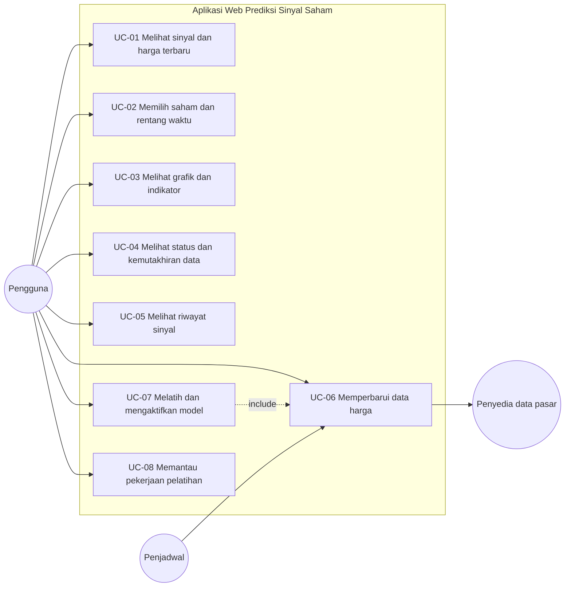

# PRD, UCD, dan PDM — Aplikasi Web Prediksi Sinyal Saham IDX

Versi 2.0 · November 2026 · Menggantikan versi 1.0 (Oktober 2026)

---

## 0. Cara membaca dokumen ini

Dokumen ini disusun sebagai satu alur turun, bukan kumpulan bagian yang berdiri sendiri. Setiap bagian memakai luaran bagian sebelumnya dan tidak melompat ke belakang.

1. Bagian 1 menetapkan masalah dan batas produk.
2. Bagian 2 menelaah cara model prediksi yang sudah ada dibuat, beserta temuannya.
3. Bagian 3 menurunkan dasar teori dari telaah tersebut.
4. Bagian 4 menetapkan tujuan dan ukuran keberhasilan.
5. Bagian 5 sampai 7 menetapkan aktor, use case, kebutuhan fungsional, dan kebutuhan non-fungsional.
6. Bagian 8 menerjemahkan kebutuhan menjadi model data fisik.
7. Bagian 9 dan 10 menerjemahkan kebutuhan menjadi arsitektur layanan dan rancangan antarmuka.
8. Bagian 11 sampai 13 menetapkan rencana pengembangan, rencana pengujian, dan risiko.
9. Bagian 14 memuat daftar pustaka yang dipakai pada seluruh dokumen.
10. Lampiran memuat matriks keterlacakan dari kebutuhan sampai pengujian.

Kode yang dipakai konsisten dari awal sampai akhir: `FR-01` sampai `FR-17` untuk kebutuhan fungsional, `NFR-01` sampai `NFR-11` untuk kebutuhan non-fungsional, `UC-01` sampai `UC-08` untuk use case, dan `T-01` sampai `T-08` untuk temuan telaah model.

---

## 1. Ringkasan produk dan batas masalah

Aplikasi web ini menyajikan sinyal **Buy**, **Hold**, dan **Sell** untuk sepuluh emiten LQ45 pada lima rentang waktu prediksi, yaitu 1, 5, 10, 20, dan 50 hari. Aplikasi memakai modul prediksi Python yang sudah tersedia, memperbarui data harga secara berkala, menjalankan pelatihan model atas permintaan pengguna, dan menyimpan riwayat sehingga setiap sinyal dapat ditelusuri ke versi model yang menghasilkannya.

Produk ini adalah sistem pendukung keputusan. Aplikasi tidak mengirim order ke sekuritas mana pun.

**Termasuk pada versi 1.0 aplikasi:**

- Pembaruan data harga harian otomatis pada hari bursa dan pembaruan manual dari dashboard.
- Perhitungan indikator teknikal dari data harga yang tersimpan.
- Penyajian lima sinyal per saham beserta harga acuan, harga perkiraan, persentase perubahan, ambang sinyal, perkiraan tanggal, dan berkas model.
- Pelatihan model atas permintaan, pemantauan status pekerjaan, dan pengaktifan versi model.
- Riwayat sinyal, riwayat pelatihan, dan riwayat pembaruan data.
- Mode terang dan mode gelap.

**Tidak termasuk pada versi 1.0:**

- Transaksi otomatis, integrasi sekuritas, pengelolaan portofolio, dan notifikasi.
- Akun pengguna dan pembatasan hak akses.
- Perubahan arsitektur model, daftar fitur, atau konfigurasi pelatihan penelitian acuan.
- Pengujian pada lingkungan perdagangan sesungguhnya.

**Perbedaan dengan versi 1.0 dokumen ini.** Versi 1.0 memakai daftar use case, kebutuhan, dan tabel basis data yang disusun ulang sendiri, sehingga tidak sejalan dengan proposal tugas akhir. Versi 2.0 memakai aktor, `UC-01` sampai `UC-08`, `FR-01` sampai `FR-17`, `NFR-01` sampai `NFR-11`, dan tujuh tabel basis data yang sama dengan proposal. Versi 2.0 juga menambahkan Bagian 2 dan Bagian 3, yaitu telaah proses pembuatan model dan dasar teorinya, karena keputusan rancangan pada bagian berikutnya bergantung pada keduanya.

---

## 2. Analisis proses pembuatan model yang tersedia

Bagian ini menelaah modul yang akan diwadahi aplikasi. Telaah dilakukan atas empat berkas program, yaitu `data_pipeline.py` (penyiapan data), `training_engine.py` (pelatihan tiga jalur), `model_service.py` (pelayanan prediksi), dan `backtest_models.py` (pemeriksaan ulang dan uji luar sampel). Telaah ini menentukan batas pekerjaan: aplikasi tidak mengubah model, tetapi aplikasi harus tahu persis apa yang dilayaninya.

### 2.1 Alur pembuatan model, dari data mentah sampai sinyal

Proses berjalan dalam enam langkah yang berurutan.

**Langkah 1 — Pengambilan data harga.** Data harian open, high, low, close, dan volume diambil untuk sepuluh emiten. Data ini menjadi bahan seluruh perhitungan berikutnya.

**Langkah 2 — Perhitungan empat belas indikator teknikal.** `TechnicalIndicatorExtractor.compute_indicators` menghitung delapan moving average (SMA dan EMA periode 5, 10, 20, 50), RSI periode 14, MACD 12-26 beserta garis sinyal 9, dan tiga garis Bollinger Bands periode 20 dengan dua simpangan baku. Hasilnya empat belas kolom baru.

**Langkah 3 — Pelabelan sentimen berita.** Judul berita dibersihkan (huruf kecil, tanda baca dibuang, stopword Indonesia dibuang), lalu diberi label oleh pengklasifikasi SVM yang dilatih bertahap. Pelabelan dimulai dari ambang keyakinan 0,95 dan diturunkan 0,05 per putaran sampai 0,80. Berita di bawah ambang terendah dibiarkan tanpa label, bukan dipaksa menjadi netral. Hasilnya lima agregat harian: jumlah berita negatif, positif, netral, total berita, dan satu label sentimen harian.

**Langkah 4 — Penggabungan data multimodal tanpa kebocoran waktu.** `TemporalDataFuser` menetapkan aturan potong pukul 16.00 WIB. Berita yang terbit pada atau setelah pukul 16.00 dipindahkan ke hari perdagangan berikutnya, dan berita akhir pekan digeser ke Senin. Setelah tanggalnya diselaraskan, sentimen diagregasi per tanggal dan digabungkan ke data harga. Aturan ini mencegah model memakai berita yang belum terbit pada saat prediksi dibuat. Total fitur menjadi sembilan belas.

**Langkah 5 — Pelabelan target dan pelatihan tiga jalur.** `HybridEnsembleEngine.prepare_sequences` menghitung imbal hasil masa depan sebesar `(close[t+h] - close[t]) / close[t]` dengan `h` adalah rentang waktu. Imbal hasil di atas ambang menjadi Buy, di bawah ambang negatif menjadi Sell, dan sisanya Hold. Data disusun menjadi jendela bergeser, lalu tiga jalur dilatih. Jalur pertama adalah regresi harga LSTM tiga lapis dengan 96 unit tersembunyi. Jalur kedua adalah voting lima pengklasifikasi, yaitu Random Forest, AdaBoost, XGBoost, SVM, dan K-Nearest Neighbors. Jalur ketiga adalah voting empat pengklasifikasi berulang, yaitu LSTM, Bi-LSTM, GRU, dan Bi-GRU.

**Langkah 6 — Penggabungan suara dan penyimpanan artefak.** Keluaran regresi harga dikonversi lebih dahulu menjadi kelas sinyal memakai ambang yang sama, agar ketiga jalur menghasilkan bentuk keluaran yang serupa. Suara terbanyak dari tiga jalur ditetapkan sebagai sinyal akhir. Artefak disimpan per saham dan per rentang waktu.

### 2.2 Apa yang benar-benar dilayani aplikasi

Telaah atas `model_service.py` menunjukkan satu hal yang menentukan seluruh rencana pengembangan. Berkas yang dimuat layanan adalah `LSTM_{saham}_Target_{rentang}.h5` dengan bentuk masukan `(rentang, 1)`. Artinya, sinyal yang tampil di dashboard berasal dari **satu jalur regresi harga LSTM atas deret harga penutupan saja**, bukan dari ensemble tiga jalur atas sembilan belas fitur. Ensemble tiga jalur ada pada `training_engine.py`, tetapi jalur pelayanan tidak memanggilnya.

Konsekuensinya harus ditulis terbuka, bukan disembunyikan. Angka akurasi 89,34 persen pada ADRO dan rata-rata 90,53 persen pada sepuluh emiten LQ45 adalah capaian ensemble tiga jalur pada penelitian acuan (Wijaya dkk., 2026). Angka itu tidak boleh dipakai sebagai klaim capaian aplikasi, karena aplikasi melayani jalur yang berbeda. Klaim yang sah untuk aplikasi adalah kesesuaian keluaran terhadap modul acuan, dan perbandingan terhadap garis dasar, sebagaimana ditetapkan pada Bagian 12.

### 2.3 Temuan telaah

Delapan temuan berikut menjadi dasar keputusan rancangan pada bagian selanjutnya. Setiap temuan menyebut berkas dan fungsi tempat masalahnya berada.

| Kode | Temuan | Bukti | Akibat bila dibiarkan | Keputusan |
|------|--------|-------|----------------------|-----------|
| T-01 | Penskalaan fitur dilatih pada seluruh data sebelum pembagian latih dan uji | `training_engine.py`, `HybridEnsembleEngine.prepare_sequences` memanggil `scaler.fit_transform(df_clean[feature_cols])` sebelum pemisahan 80/20 | Nilai tengah dan simpangan baku data uji ikut masuk ke pelatihan, sehingga metrik uji terlihat lebih baik daripada kemampuan sebenarnya | Pelatihan ulang di aplikasi memasang skala hanya pada data latih, lalu menyimpan `mean_` dan `scale_` pada versi model (`FR-14`, `NFR-05`) |
| T-02 | Artefak yang dilayani hanya jalur regresi harga, bukan ensemble | `model_service.py`, `_load_model` memeriksa bentuk masukan `(rentang, 1)` | Klaim akurasi ensemble tidak berlaku bagi aplikasi, dan pengguna dapat menyimpulkan lebih dari yang terukur | Batas masalah ditulis eksplisit (Bagian 1 dan 2.2); pengujian aplikasi memakai kesesuaian keluaran dan garis dasar, bukan angka penelitian acuan |
| T-03 | Skala masukan dan skala target direkonstruksi ulang setiap kali, tidak disimpan | `model_service.py`, `_load_training_scaler` dan `_load_target_scaler` memanggil `train_test_split(..., random_state=0)` atas berkas CSV lalu melatih `StandardScaler` baru | Nilai prediksi bergantung pada pustaka scikit-learn (Pedregosa dkk., 2011), versi, dan keberadaan berkas CSV; perubahan kecil dapat menggeser harga perkiraan tanpa perubahan model | Setiap versi model menyimpan parameter skala sebagai JSON pada `model_versions.scaler`, dan pelayanan membacanya dari basis data (`FR-14`, `NFR-05`) |
| T-04 | Ambang sinyal diperiksa dengan aturan berbeda di dua tempat | `model_service.py`, `classify_return` memakai `math.isclose` sehingga nilai tepat sama dengan ambang menjadi Buy atau Sell; `backtest_models.py`, `classify` memakai `>=` dan `<=` | Satu baris data pada batas ambang dapat dinilai berbeda oleh aplikasi dan oleh alat uji, sehingga pengujian kesesuaian keluaran gagal tanpa sebab yang jelas | Ambang dan aturan batas ditetapkan satu kali pada satu fungsi bersama, dipakai aplikasi dan alat uji (`FR-03`, `NFR-03`) |
| T-05 | Aturan penentu saat suara ketiga jalur berbeda tidak ditetapkan | `training_engine.py`, `predict_signals` memakai `scipy.stats.mode` atas tiga baris suara | Ketika tiga jalur memberi tiga kelas berbeda, nilai yang dipilih bergantung pada perilaku pustaka, bukan pada keputusan yang dapat dipertanggungjawabkan | Aturan ditetapkan tertulis: pada suara seri, Hold menang, karena Hold adalah kelas mayoritas dan keputusan paling konservatif bagi sistem pendukung keputusan |
| T-06 | Konfigurasi pelatihan tidak tercatat bersama artefak | `training_engine.py` tidak menulis berkas konfigurasi atau metrik; `model_service.py` hanya membaca berkas `.h5` | Sinyal tidak dapat ditelusuri ke konfigurasi dan metrik yang menghasilkannya | `model_versions` menyimpan `config`, `metrics`, dan `scaler` sebagai JSON, dan setiap `predictions` wajib mengacu pada satu versi (`FR-04`, `FR-14`) |
| T-07 | Konfigurasi pelatihan pada proposal berbeda dengan yang dijalankan kode | Proposal menyebut maksimum 50 epoch, batch 32, dan penghentian awal; `train_path1` dan `train_path3` memakai bawaan `epochs=30` tanpa penghentian awal | Laporan menjanjikan sesuatu yang tidak dijalankan, dan hasil pelatihan ulang tidak dapat dibandingkan dengan artefak acuan | Tabel konfigurasi pada proposal disamakan dengan kode, atau kode disamakan dengan tabel; PRD memakai nilai kode sebagai keadaan sekarang dan mencatat perbedaannya sebagai pekerjaan Tahap 5 |
| T-08 | Akurasi mudah menyesatkan karena kelas Hold mendominasi | `backtest_models.py`, `signal_accuracy` sudah menghitung garis dasar selalu-Hold, tetapi tidak melaporkan presisi dan sensitivitas per kelas | Model yang selalu menebak Hold dapat terlihat akurat | Metrik wajib: akurasi, presisi, sensitivitas, F1 makro, dan F1 per kelas, disandingkan dengan garis dasar selalu-Hold dan garis dasar harga tidak berubah (`NFR-03`, Bagian 12) |

Temuan T-01 sampai T-08 tidak mengubah batas masalah penelitian. Perbaikan T-01, T-03, T-04, T-06, dan T-07 dilakukan pada sisi pelayanan, penyimpanan, dan pencatatan, yaitu bagian yang memang menjadi lingkup pekerjaan aplikasi. Perbaikan T-02 dan T-05 hanya dicatat sebagai batas dan aturan, bukan sebagai penggantian arsitektur model.

---

## 3. Dasar teori

Bagian ini menyebut dasar teori yang dipakai untuk membenarkan keputusan pada Bagian 5 sampai 10. Setiap butir menyebut sumbernya, dan sumber yang sama dipakai lagi pada daftar pustaka Bagian 14.

### 3.1 Sistem pendukung keputusan

Sistem pendukung keputusan mengolah data dan model untuk menyajikan informasi bagi pengambil keputusan pada persoalan semi-terstruktur. Sistem ini tidak menggantikan pengambil keputusan. Karena itu aplikasi menampilkan sinyal beserta asal-usulnya, dan tidak menjalankan transaksi. Keputusan membeli atau menjual tetap berada pada pengguna, sehingga keterangan "bukan saran investasi" menjadi kebutuhan wajib (`FR-17`), bukan hiasan halaman.

### 3.2 Aturan pelabelan sinyal dan ambang per rentang waktu

Sinyal ditentukan dari perbandingan harga penutupan saat ini dengan harga penutupan pada hari target. Selisih relatifnya dibandingkan dengan ambang `k`. Semakin panjang rentang waktu, semakin besar ambang, karena rentang pergerakan harga yang mungkin terjadi ikut bertambah. Nilai ambang pada setiap rentang waktu disajikan pada Tabel 3.1.

**Tabel 3.1** Ambang perubahan harga pada setiap rentang waktu

| Rentang target (hari) | Ambang naik atau turun (%) |
|---|---|
| 1 | 1,5 |
| 5 | 3,0 |
| 10 | 6,0 |
| 20 | 9,0 |
| 50 | 11,0 |

Sumber: Wijaya dkk. (2026), sesuai nilai yang dipakai `model_service.py` pada `RETURN_THRESHOLDS`.

Aturan ini menghasilkan ketidakseimbangan kelas, karena Hold umumnya lebih banyak daripada Buy dan Sell. Ketidakseimbangan tersebut menjadi alasan mengapa evaluasi pada Bagian 12 tidak boleh berhenti pada akurasi (T-08).

### 3.3 Indikator teknikal

Indikator teknikal meringkas data transaksi harian menjadi ukuran tren, momentum, dan volatilitas. Lima keluarga indikator yang dipakai adalah Simple Moving Average, Exponential Moving Average, Relative Strength Index, Moving Average Convergence/Divergence, dan Bollinger Bands. Kinerja MACD dan RSI sebagai osilator pernah diuji ulang oleh Chong dkk. (2014), dan hasilnya dipakai sebagai rujukan bahwa indikator saja tidak cukup tanpa pemodelan. Pada aplikasi, indikator tidak dipakai untuk menghitung sinyal, tetapi ditampilkan sebagai bahan pembacaan pengguna (`FR-05`, `FR-06`).

### 3.4 Recurrent Neural Network dan LSTM

RNN memproses data berurutan dengan mempertahankan keadaan tersembunyi dari langkah waktu sebelumnya. RNN sederhana sulit mempelajari ketergantungan jangka panjang karena pengaruh gradien yang mengecil. LSTM menambahkan sel keadaan beserta gerbang masukan, lupaan, dan keluaran sehingga informasi dapat disimpan atau dibuang secara terkendali (Hochreiter & Schmidhuber, 1997). Sifat ini yang membuat LSTM dipakai pada deret harga, termasuk pada prediksi rekomendasi jual dan beli di bursa Thailand (Sanboon dkk., 2019).

### 3.5 Ensemble learning dan penggabungan suara

Ensemble learning menggabungkan keluaran beberapa model menjadi satu keputusan untuk menurunkan varians dan menaikkan kestabilan (Mienye & Sun, 2022). Penggabungan dapat dilakukan dengan rata-rata, penjumlahan bobot, atau suara terbanyak. Suara terbanyak dipakai pada penelitian acuan dan pada `training_engine.py`. Karena jumlah anggota jalur ganjil, tiga, hasil voting selalu punya mayoritas, kecuali ketika ketiga jalur memberi tiga kelas berbeda. Kasus itu ditetapkan pada T-05.

### 3.6 Rekayasa perangkat lunak dan metode prototyping

Rekayasa perangkat lunak menempatkan penetapan spesifikasi, pengembangan, pengesahan, dan evolusi sebagai aktivitas yang saling memeriksa (Sommerville, 2016). Dokumen hasil analisis dan perancangan menjadi dasar implementasi dan pengujian (Pressman & Maxim, 2020). Metode prototyping dipilih karena kebutuhan bentuk antarmuka lebih mudah disempurnakan setelah calon pengguna mencoba purwarupa. Risiko metode ini, yaitu purwarupa dianggap produk akhir dan pilihan teknis cepat dipakai terbawa ke penyebaran, ditekan dengan menetapkan lebih awal bagian mana yang sementara. Pada penelitian ini bagian perhitungan tidak dibangun ulang, sehingga risiko tersebut menyempit ke bagian antarmuka.

### 3.7 Pemodelan use case dan diagram aktivitas

UML menyediakan notasi untuk menggambarkan rancangan sebelum kode ditulis (Fowler, 2004). Use case diagram menempatkan sistem sebagai satu batas, aktor di luar batas, dan tujuan setiap aktor di dalamnya. Rincian langkah setiap tujuan ditulis pada skenario yang memuat prakondisi, pemicu, alur utama, alur alternatif, dan pascakondisi (Reda & Shalahuddin, 2018). Diagram aktivitas melengkapi use case dengan memperlihatkan bagian alur yang bercabang, misalnya ketika sebuah proses berhasil, gagal, atau dilewati.

### 3.8 Rancangan antarmuka yang berpusat pada pengguna

Perancangan berpusat pada pengguna menempatkan kebutuhan pengguna sebagai dasar keputusan dan menempuh putaran rancangan, evaluasi, dan perbaikan (ISO, 2019). Evaluasi tidak menunggu produk selesai; purwarupa yang dapat dicoba sudah cukup untuk menemukan bagian yang membingungkan. Nielsen (1993) menambahkan kesesuaian bahasa antarmuka dengan dunia pengguna, umpan balik atas setiap tindakan, dan pencegahan kesalahan yang dapat diperediksi. Aksesibilitas diatur WCAG 2.1 (W3C, 2018): kontras teks minimal 4,5 banding 1, seluruh kontrol dapat dijangkau papan tuntas, dan penanda fokus terlihat. Ketentuan ini masuk sebagai `NFR-07`, `NFR-08`, dan `NFR-09`, bukan sebagai pekerjaan tambahan setelah aplikasi selesai.

### 3.9 Arsitektur aplikasi web dan REST

Aplikasi web memisahkan bagian penyajian dari bagian pengolahan. Pola client-server membuat perubahan tampilan tidak menuntut perubahan logika perhitungan. Gaya arsitektur REST menyatakan setiap sumber daya melalui satu alamat dan memakai metode HTTP untuk menyatakan tindakan (Fielding, 2000). Pemisahan ini juga memisahkan tanggung jawab pengujian, karena keluaran layanan dapat diperiksa tanpa melalui antarmuka. Rancangan komponen yang lebih luas, termasuk pertimbangan mutu atribut, mengikuti Bass dkk. (2021).

### 3.10 Pengelolaan versi model dan penelusuran keluaran

Ketika pelatihan dijalankan lebih dari sekali, satu sinyal tanpa penanda versi tidak dapat dipertanggungjawabkan. Karena itu setiap artefak diberi keterangan saham, rentang waktu, waktu pelatihan, konfigurasi, dan metrik, dan setiap baris sinyal mengacu pada satu versi. Versi hasil pelatihan ulang disimpan sebagai kandidat dan baru dipakai setelah diaktifkan, sehingga satu kali pelatihan yang kurang baik tidak langsung menggantikan model acuan. Kebutuhan ini menjadi `FR-13`, `FR-14`, dan `FR-15`, serta aturan integritas pada Bagian 8.

### 3.11 Data pasar, kalender bursa, dan pencegahan kebocoran waktu

Data pasar berbentuk deret harian. Penyedia data punya kebijakan waktu sendiri, sehingga sistem mencatat waktu pengambilan dan menampilkannya bersama sinyal. Hari libur bursa tidak menghasilkan data baru, sehingga permintaan pada hari tersebut dicatat sebagai dilewati, bukan gagal. Data untuk menghitung fitur dibatasi pada data yang tersedia sebelum waktu prediksi dibuat, dan aturan potong 16.00 WIB pada `data_pipeline.py` adalah penerapan aturan tersebut. Prinsip ini menjadi alasan mengapa tanggal data terakhir selalu tampil bersama sinyal (`FR-04`).

### 3.12 Pengujian perangkat lunak

Pengujian memeriksa kesesuaian perangkat lunak dengan kebutuhan. Pengujian kotak hitam menilai perilaku dari masukan dan keluaran tanpa memperhatikan susunan kode; pengujian kotak putih menelusuri jalur di dalam kode (Sommerville, 2016). Pada penelitian ini, pengujian fungsional memakai kotak hitam atas daftar kebutuhan dan use case; pengujian kesesuaian keluaran membandingkan aplikasi dengan modul acuan; pengujian kinerja mengukur waktu tanggap; pengujian ketahanan menguji kegagalan pengambilan data dan pelatihan yang tidak selesai; dan pengujian kelayakan penggunaan memakai tugas terarah beserta tanggapan calon pengguna (Nielsen, 1993). Penyiapan data uji mengikuti kaidah penambangan data, termasuk pemisahan data latih dan uji secara kronologis (Han dkk., 2023).

---

## 4. Tujuan dan ukuran keberhasilan

| No | Tujuan | Ukuran keberhasilan | Kebutuhan terkait |
|----|--------|---------------------|-------------------|
| 1 | Menyajikan sinyal tanpa menjalankan skrip | Lima sinyal tampil untuk saham terpilih tanpa interaksi terminal | `FR-01` sampai `FR-04` |
| 2 | Menjaga data harga tetap mutakhir | Pembaruan berhasil pada minimal 95 persen hari bursa dalam satu bulan | `FR-11`, `NFR-04` |
| 3 | Memberi akses pelatihan dari peramban | Pekerjaan pelatihan dapat dimulai, dipantau, dan versinya diaktifkan dari dashboard | `FR-12` sampai `FR-15` |
| 4 | Menjaga jejak keluaran | Setiap sinyal dapat ditelusuri ke satu versi model dan satu tanggal data | `FR-04`, `FR-08`, `NFR-05` |
| 5 | Menjaga keluaran tetap setara modul acuan | Sinyal aplikasi identik dengan modul acuan pada data dan model yang sama | `NFR-03`, Bagian 12 |
| 6 | Dapat dipakai tanpa bantuan | Seluruh tugas terarah selesai tanpa bantuan pendamping | `NFR-07` sampai `NFR-09`, Bagian 12 |

Ukuran nomor 5 menggantikan ukuran versi 1.0 yang menyebut angka akurasi 89 persen sebagai target, karena alasan pada T-02. Angka akurasi tetap dilaporkan sebagai pembanding pada laporan pengujian, bukan sebagai janji capaian aplikasi.

---

## 5. Aktor

Aktor ditetapkan lebih dahulu karena seluruh use case pada Bagian 6 mengacu pada tabel ini.

**Tabel 5.1** Aktor yang berinteraksi dengan sistem

| Aktor | Jenis | Peran |
|---|---|---|
| Pengguna | Manusia | Investor ritel, mahasiswa, atau peneliti yang membuka dashboard untuk melihat sinyal, memantau data, melatih model, dan mengaktifkan versi model. |
| Penjadwal | Sistem | Proses terjadwal yang berjalan pada hari bursa dan memicu pembaruan data harga beserta perhitungan sinyal. |
| Penyedia data pasar | Sistem luar | Layanan berbasis web yang menyediakan data harga harian dan harga intrahari untuk saham yang terdaftar di Bursa Efek Indonesia. |
| Pekerja pelatihan | Sistem | Proses yang menjalankan pelatihan model pada data yang tersedia, menghitung metrik pada data uji, dan menyimpan artefak model. |

Pekerja pelatihan tidak digambarkan sebagai aktor di luar batas sistem pada diagram, karena peran itu dijalankan oleh layanan pelatihan di dalam aplikasi. Keterlibatannya tampak pada `UC-07` dan `UC-08`.

---

## 6. Use case

### 6.1 Daftar use case

**Tabel 6.1** Daftar use case aplikasi web

| Kode | Use case | Ringkasan | Aktor utama | Kebutuhan |
|---|---|---|---|---|
| UC-01 | Melihat sinyal dan harga terbaru | Pengguna menampilkan lima sinyal terbaru pada saham terpilih beserta harga acuan dan harga perkiraannya. | Pengguna | `FR-01` sampai `FR-04` |
| UC-02 | Memilih saham dan rentang waktu | Pengguna mengganti saham yang diamati atau rentang waktu pada panel riwayat sinyal. | Pengguna | `FR-02`, `FR-08` |
| UC-03 | Melihat grafik harga dan indikator terbaru | Pengguna melihat grafik harga penutupan 180 sesi terakhir dan enam indikator terbaru. | Pengguna | `FR-05`, `FR-06` |
| UC-04 | Melihat status dan kemutakhiran data | Pengguna melihat waktu pembaruan terakhir, jumlah catatan, kelengkapan model, dan jadwal pembaruan berikutnya. | Pengguna | `FR-07` |
| UC-05 | Melihat riwayat sinyal | Pengguna menelusuri sinyal terdahulu untuk membandingkan keluaran antar tanggal. | Pengguna | `FR-08` |
| UC-06 | Memperbarui data harga | Sistem menarik data harga terbaru, menghitung indikator, menjalankan model, dan menyimpan sinyal. | Pengguna, Penjadwal, Penyedia data pasar | `FR-09` sampai `FR-11` |
| UC-07 | Melatih dan mengaktifkan model | Pengguna mengantre pekerjaan pelatihan, memantau hasilnya, lalu mengaktifkan versi model yang akan dipakai. | Pengguna, Pekerja pelatihan | `FR-12` sampai `FR-15` |
| UC-08 | Memantau pekerjaan pelatihan | Pengguna melihat status setiap pekerjaan pelatihan beserta pesan kegagalannya bila ada. | Pengguna | `FR-07`, `FR-12`, `FR-14` |

`FR-16` (mode terang dan gelap) dan `FR-17` (keterangan bukan saran investasi) berlaku pada seluruh use case, sehingga tidak diberi use case tersendiri.

### 6.2 Diagram use case



Relasi include pada diagram menyatakan bahwa pelatihan memerlukan data harga yang sudah diperbarui.

### 6.3 Skenario UC-01 Melihat sinyal dan harga terbaru

| Unsur | Keterangan |
|---|---|
| Nama use case | Melihat sinyal dan harga terbaru (`UC-01`) |
| Aktor | Pengguna |
| Prakondisi | Aplikasi terbuka pada peramban dan daftar saham sudah tersedia di layanan. |
| Pemicu | Pengguna membuka halaman dashboard. |
| Alur utama | 1. Antarmuka meminta daftar saham kepada layanan. 2. Layanan mengembalikan sepuluh saham beserta harga penutupan terakhirnya. 3. Antarmuka memilih saham pertama dan meminta sinyal untuk saham itu. 4. Layanan membaca sinyal terbaru untuk lima rentang waktu. 5. Antarmuka menampilkan tabel sinyal beserta harga acuan, harga perkiraan, perubahan, ambang, perkiraan tanggal, dan berkas modelnya. |
| Alur alternatif | A1. Belum ada sinyal tersimpan; sistem menampilkan ajakan memperbarui harga beserta tombolnya. A2. Permintaan gagal; sistem menampilkan penyebab kegagalan dan tombol coba lagi. |
| Pascakondisi | Pengguna melihat lima sinyal terbaru beserta keterangan yang menyertainya. |

### 6.4 Skenario UC-06 Memperbarui data harga

| Unsur | Keterangan |
|---|---|
| Nama use case | Memperbarui data harga (`UC-06`) |
| Aktor | Pengguna, Penjadwal, dan Penyedia data pasar |
| Prakondisi | Koneksi menuju penyedia data pasar tersedia dan daftar saham sudah tersimpan. |
| Pemicu | Pengguna menekan tombol perbarui harga, atau jadwal pembaruan harian terpenuhi. |
| Alur utama | 1. Layanan menerima pemicu beserta jenisnya, manual atau terjadwal. 2. Layanan memeriksa apakah hari itu hari bursa atau permintaan berasal dari pengguna. 3. Layanan meminta data harga harian untuk sepuluh emiten. 4. Layanan menyimpan data harga dan menghitung indikator teknikalnya. 5. Layanan menjalankan model untuk lima rentang waktu. 6. Layanan menyimpan sinyal beserta versi model dan perkiraan tanggalnya. 7. Layanan mencatat hasil pembaruan beserta jumlah barisnya. 8. Antarmuka menampilkan pesan hasil dan memuat ulang seluruh panel. |
| Alur alternatif | A1. Hari libur bursa; sistem mencatat status dilewati dan tidak meminta data. A2. Data tidak lengkap; sistem tidak menyimpan baris tersebut dan mencatat kegagalannya. A3. Penyedia data tidak merespons; sistem mengulang permintaan sesuai batas, lalu mencatat kegagalan. A4. Pembaruan lain sedang berjalan; sistem menolak permintaan baru dan mencatat alasannya. |
| Pascakondisi | Data harga, indikator, dan sinyal terbaru tersimpan, dan riwayat pembaruan bertambah satu baris. |

### 6.5 Skenario UC-07 Melatih dan mengaktifkan model

| Unsur | Keterangan |
|---|---|
| Nama use case | Melatih dan mengaktifkan model (`UC-07`) |
| Aktor | Pengguna dan Pekerja pelatihan |
| Prakondisi | Data harga untuk saham terpilih sudah tersimpan dan artefak model acuan tersedia. |
| Pemicu | Pengguna menekan tombol latih model pada panel model dan pelatihan. |
| Alur utama | 1. Pengguna memilih rentang waktu dan menandai paksa latih ulang bila perlu. 2. Layanan memeriksa apakah model untuk kombinasi saham dan rentang waktu itu sudah ada. 3. Layanan membuat pekerjaan pelatihan berstatus dalam antrean. 4. Pekerja pelatihan melatih model pada data yang tersedia dan menghitung metrik pada data uji. 5. Layanan menyimpan artefak model, parameter skala, dan metriknya sebagai versi kandidat. 6. Pengguna menekan tombol jadikan aktif pada versi tersebut. 7. Layanan menandai versi itu aktif dan memakainya pada prediksi berikutnya. |
| Alur alternatif | A1. Model sudah ada dan pengguna tidak memaksa latih ulang; sistem memakai model yang tersedia dan memberi pesan bahwa versi itu dipakai ulang. A2. Pelatihan gagal; status menjadi gagal, pesan galat dicatat, dan tidak ada versi baru yang disimpan. |
| Pascakondisi | Versi model aktif bertambah dan setiap sinyal berikutnya mencatat nomor versi tersebut. |

Langkah 5 pada `UC-07` memuat perbaikan T-01 dan T-03: parameter skala disimpan, bukan direkonstruksi. Langkah 2 memuat `FR-13`, yaitu pemakaian ulang model yang sudah ada.

---

## 7. Kebutuhan fungsional dan non-fungsional

### 7.1 Kebutuhan fungsional

**Tabel 7.1** Kebutuhan fungsional aplikasi web

| Kode | Kebutuhan | Prioritas | Use case |
|---|---|---|---|
| FR-01 | Sistem menampilkan daftar sepuluh saham pilihan beserta harga penutupan terakhir dan sektornya. | Wajib | `UC-01` |
| FR-02 | Pengguna dapat memilih salah satu saham dari daftar tersebut. | Wajib | `UC-01`, `UC-02` |
| FR-03 | Sistem menampilkan sinyal Buy, Hold, atau Sell untuk lima rentang waktu pada saham terpilih. | Wajib | `UC-01` |
| FR-04 | Sistem menampilkan harga acuan, harga perkiraan, persentase perubahan, ambang sinyal, perkiraan tanggal, dan nama berkas model untuk setiap sinyal. | Wajib | `UC-01` |
| FR-05 | Sistem menampilkan grafik harga penutupan 180 sesi terakhir beserta garis SMA 20 sesi dan ringkasan rentang harganya. | Dianjurkan | `UC-03` |
| FR-06 | Sistem menampilkan indikator terbaru berupa SMA 20, SMA 50, RSI 14, MACD, serta Bollinger atas dan bawah. | Dianjurkan | `UC-03` |
| FR-07 | Sistem menampilkan status kemutakhiran data, jenis penyimpanan, jumlah catatan harga, jumlah riwayat sinyal, jumlah emiten yang modelnya lengkap, dan jadwal pembaruan otomatis. | Wajib | `UC-04`, `UC-08` |
| FR-08 | Sistem menampilkan riwayat sinyal pada saham terpilih untuk rentang waktu yang dipilih pengguna. | Wajib | `UC-02`, `UC-05` |
| FR-09 | Sistem menampilkan riwayat setiap percobaan pembaruan data beserta waktu, status, jenis pemicu, jumlah baris, dan pesannya. | Wajib | `UC-06` |
| FR-10 | Pengguna dapat memicu pembaruan data harga secara manual dari halaman dashboard. | Wajib | `UC-06` |
| FR-11 | Sistem memperbarui data harga secara otomatis pada hari bursa sesuai jadwal yang ditetapkan. | Wajib | `UC-06` |
| FR-12 | Pengguna dapat mengantre pekerjaan pelatihan model untuk saham dan rentang waktu tertentu. | Wajib | `UC-07`, `UC-08` |
| FR-13 | Sistem memakai model yang sudah tersedia tanpa melatih ulang, kecuali pengguna menandai paksa latih ulang. | Wajib | `UC-07` |
| FR-14 | Sistem menampilkan daftar versi model beserta asal, waktu pelatihan, akurasi, presisi, sensitivitas, F1, dan berkas artefaknya. | Wajib | `UC-07`, `UC-08` |
| FR-15 | Pengguna dapat mengaktifkan versi model hasil pelatihan ulang sehingga dipakai pada prediksi berikutnya. | Wajib | `UC-07` |
| FR-16 | Sistem menyediakan mode terang dan mode gelap yang pilihannya disimpan pada peramban pengguna. | Dianjurkan | Semua |
| FR-17 | Sistem menampilkan keterangan bahwa sinyal bukan saran investasi dan aplikasi tidak bertransaksi. | Wajib | Semua |

### 7.2 Kebutuhan non-fungsional

**Tabel 7.2** Kebutuhan non-fungsional aplikasi web

| Kode | Kategori | Kebutuhan |
|---|---|---|
| NFR-01 | Kinerja | Permintaan pembacaan data melalui endpoint selesai di bawah 1 detik pada kondisi normal. |
| NFR-02 | Kinerja | Sinyal pertama tampil di halaman dashboard dalam waktu kurang dari 3 detik pada koneksi standar. |
| NFR-03 | Kinerja dan ketepatan | Permintaan prediksi memakai model tersimpan dan tidak menjalankan pelatihan ulang; ambang sinyal dan aturan batasnya ditetapkan pada satu fungsi bersama. |
| NFR-04 | Keandalan | Kegagalan pengambilan data tidak menghapus data yang sudah tersimpan. |
| NFR-05 | Keandalan | Model yang belum selesai dilatih tidak dipakai untuk memprediksi dan tidak menggantikan model aktif; parameter skala disimpan bersama versi model. |
| NFR-06 | Keandalan | Dua proses pembaruan data tidak boleh berjalan bersamaan pada satu waktu. |
| NFR-07 | Kegunaan | Seluruh kontrol dapat dijangkau dan diaktifkan memakai papan tuntas tanpa tetikus. |
| NFR-08 | Kegunaan | Kontras teks memenuhi kriteria WCAG 2.1 tingkat AA (W3C, 2018). |
| NFR-09 | Kegunaan | Setiap keadaan kosong, memuat, dan galat menjelaskan penyebabnya dan langkah berikutnya, bukan hanya menampilkan kode kesalahan. |
| NFR-10 | Pemeliharaan | Konfigurasi dan kredensial disimpan pada variabel lingkungan, tidak ditulis di dalam repositori. |
| NFR-11 | Portabilitas | Aplikasi dapat dijalankan pada layanan awan tanpa perubahan kode dengan basis data PostgreSQL. |

`NFR-03` dan `NFR-05` memuat perbaikan T-04, T-03, dan T-06. Tidak ada kebutuhan baru di luar daftar proposal, sehingga penomoran tetap dapat dirujuk dari dokumen proposal.

---

## 8. Physical Data Model

Basis data: PostgreSQL 15 atau lebih baru. Seluruh waktu disimpan sebagai `TIMESTAMPTZ` dalam UTC dan ditampilkan dalam WIB. Rancangan ini menerjemahkan kebutuhan pada Tabel 7.1 dan 7.2 menjadi tujuh tabel, sesuai jumlah tabel pada proposal.

Catatan implementasi: tabel pada Bagian 8.2 adalah rancangan yang diimplementasikan di `idx_signal/models.py`. Dua penyesuaian sudah diterapkan pada kode dan dicatat di sini agar dokumen dan basis data tidak berbeda. Pertama, tabel harga bernama `daily_prices`, bukan `prices`. Kedua, tabel `technical_indicators` tidak dibuat karena indikator dihitung dari `daily_prices` saat dibaca, sehingga tidak ada kolom turunan yang perlu disimpan ulang. Sebagai gantinya, tabel `market_holidays` menyimpan kalender bursa yang dipakai menghitung tanggal target. Parameter skala tidak menjadi kolom tersendiri, melainkan disimpan di dalam `model_versions.config`, dan `model_versions.artifact_sha256` mencatat sidik artefak yang benar-benar dilayani.

### 8.1 Ringkasan tabel dan alasan keberadaannya

| Tabel | Fungsi | Kebutuhan yang dilayani |
|---|---|---|
| `stocks` | Daftar saham yang didukung beserta sektor dan status aktifnya. | `FR-01` |
| `daily_prices` | Data harga harian open, high, low, close, dan volume. | `FR-05`, `FR-11` |
| `market_holidays` | Kalender hari libur bursa untuk menghitung tanggal target. | `FR-03`, `FR-04` |
| `model_versions` | Versi model, konfigurasi, metrik, parameter skala, dan lokasi artefaknya. | `FR-04`, `FR-14`, `NFR-05` |
| `training_jobs` | Pekerjaan pelatihan beserta status dan pesan galatnya. | `FR-12`, `FR-13` |
| `predictions` | Sinyal yang dihasilkan beserta versi model dan tanggal targetnya. | `FR-03`, `FR-04`, `FR-08` |
| `data_update_logs` | Riwayat setiap percobaan pembaruan data. | `FR-09`, `FR-11` |

### 8.2 DDL

```sql
CREATE TABLE stocks (
    symbol      VARCHAR(16)  PRIMARY KEY,           -- contoh: ADRO
    name        VARCHAR(120) NOT NULL,
    sector      VARCHAR(60),
    is_active   BOOLEAN      NOT NULL DEFAULT TRUE,
    created_at  TIMESTAMPTZ  NOT NULL DEFAULT NOW()
);

CREATE TABLE daily_prices (
    symbol      VARCHAR(16)   NOT NULL REFERENCES stocks(symbol) ON DELETE CASCADE,
    trade_date  DATE          NOT NULL,
    open        NUMERIC(14,2) NOT NULL CHECK (open  >= 0),
    high        NUMERIC(14,2) NOT NULL CHECK (high  >= 0),
    low         NUMERIC(14,2) NOT NULL CHECK (low   >= 0),
    close       NUMERIC(14,2) NOT NULL CHECK (close >= 0),
    volume      BIGINT        NOT NULL CHECK (volume >= 0),
    fetched_at  TIMESTAMPTZ   NOT NULL DEFAULT NOW(),
    PRIMARY KEY (symbol, trade_date)
);

CREATE TABLE market_holidays (
    symbol       VARCHAR(16)   NOT NULL,
    trade_date   DATE          NOT NULL,
    sma_5        NUMERIC(14,4),
    sma_10       NUMERIC(14,4),
    sma_20       NUMERIC(14,4),
    sma_50       NUMERIC(14,4),
    ema_5        NUMERIC(14,4),
    ema_10       NUMERIC(14,4),
    ema_20       NUMERIC(14,4),
    ema_50       NUMERIC(14,4),
    rsi          NUMERIC(9,4),
    macd         NUMERIC(14,4),
    macd_signal  NUMERIC(14,4),
    middleband   NUMERIC(14,4),
    upperband    NUMERIC(14,4),
    lowerband    NUMERIC(14,4),
    computed_at  TIMESTAMPTZ   NOT NULL DEFAULT NOW(),
    PRIMARY KEY (symbol, trade_date),
    FOREIGN KEY (symbol, trade_date) REFERENCES prices(symbol, trade_date) ON DELETE CASCADE
);

CREATE TABLE model_versions (
    id            BIGSERIAL    PRIMARY KEY,
    symbol        VARCHAR(16)  NOT NULL REFERENCES stocks(symbol) ON DELETE CASCADE,
    horizon_days  SMALLINT     NOT NULL CHECK (horizon_days IN (1, 5, 10, 20, 50)),
    trained_at    TIMESTAMPTZ  NOT NULL DEFAULT NOW(),
    data_until    DATE         NOT NULL,
    metrics       JSONB        NOT NULL,   -- accuracy, precision, recall, f1_macro, f1_per_class
    config        JSONB        NOT NULL,   -- epoch, batch, window, seed, ambang
    artifact_path VARCHAR(255) NOT NULL,
    artifact_sha256 VARCHAR(64) NOT NULL,   -- sidik artefak yang dilayani
    is_active     BOOLEAN      NOT NULL DEFAULT FALSE,
    UNIQUE (symbol, horizon_days, trained_at)
);

CREATE TABLE training_jobs (
    id               BIGSERIAL    PRIMARY KEY,
    symbol           VARCHAR(16)  NOT NULL REFERENCES stocks(symbol) ON DELETE CASCADE,
    horizon_days     SMALLINT     NOT NULL CHECK (horizon_days IN (1, 5, 10, 20, 50)),
    status           VARCHAR(12)  NOT NULL CHECK (status IN ('queued', 'running', 'success', 'failed')),
    requested_at     TIMESTAMPTZ  NOT NULL DEFAULT NOW(),
    started_at       TIMESTAMPTZ,
    finished_at      TIMESTAMPTZ,
    error_message    TEXT,
    model_version_id BIGINT       REFERENCES model_versions(id) ON DELETE SET NULL
);

CREATE TABLE predictions (
    id                BIGSERIAL    PRIMARY KEY,
    symbol            VARCHAR(16)  NOT NULL REFERENCES stocks(symbol) ON DELETE CASCADE,
    horizon_days      SMALLINT     NOT NULL CHECK (horizon_days IN (1, 5, 10, 20, 50)),
    model_version_id  BIGINT       NOT NULL REFERENCES model_versions(id) ON DELETE RESTRICT,
    data_as_of        DATE         NOT NULL,
    target_date       DATE,
    signal            VARCHAR(4)    NOT NULL CHECK (signal IN ('BUY', 'HOLD', 'SELL')),
    predicted_price   NUMERIC(14,2),
    last_close        NUMERIC(14,2) NOT NULL CHECK (last_close > 0),
    return_pct        NUMERIC(10,4) NOT NULL,
    threshold_pct     NUMERIC(10,4) NOT NULL,
    ood_z             NUMERIC(10,4) NOT NULL DEFAULT 0,
    ood_flag          BOOLEAN       NOT NULL DEFAULT FALSE,
    warnings          TEXT,
    created_at        TIMESTAMPTZ   NOT NULL DEFAULT NOW(),
    UNIQUE (symbol, horizon_days, data_as_of, model_version_id)
);

CREATE TABLE data_update_logs (
    id            BIGSERIAL    PRIMARY KEY,
    run_at        TIMESTAMPTZ  NOT NULL DEFAULT NOW(),
    trigger_type  VARCHAR(10)  NOT NULL CHECK (trigger_type IN ('scheduled', 'manual')),
    status        VARCHAR(12)  NOT NULL CHECK (status IN ('success', 'partial', 'failed', 'skipped')),
    rows_inserted INTEGER      NOT NULL DEFAULT 0,
    message       TEXT
);
```

### 8.3 Indeks

```sql
CREATE INDEX idx_daily_prices_date        ON daily_prices (trade_date);
CREATE INDEX idx_model_versions_lookup    ON model_versions (symbol, horizon_days, is_active);
CREATE INDEX idx_training_jobs_status     ON training_jobs (status);
CREATE INDEX idx_predictions_lookup       ON predictions (symbol, horizon_days, created_at DESC);
CREATE INDEX idx_data_update_logs_run_at  ON data_update_logs (run_at DESC);
CREATE UNIQUE INDEX idx_model_versions_active
    ON model_versions (symbol, horizon_days) WHERE is_active;
```

Indeks unik parsial terakhir adalah penguatan yang disarankan, belum dipasang pada basis data yang berjalan. Versi kode saat ini menegakkan aturan satu versi aktif di `training.activate_version`, yang menonaktifkan versi lain untuk kombinasi saham dan rentang waktu yang sama dalam satu transaksi, sehingga pertanyaan "model mana yang dipakai" punya satu jawaban selama aktivasi berjalan lewat layanan. Menambah indeksnya pada basis data berisi data menuntut migrasi tersendiri.

### 8.4 Hubungan antartabel

- `stocks` 1 : N `daily_prices`, `model_versions`, `training_jobs`, `predictions`.
- `model_versions` 1 : N `predictions`; setiap sinyal wajib mengacu pada satu versi.
- `model_versions` 0..1 : N `training_jobs` melalui `model_version_id`.
- `training_jobs` yang gagal tidak menghasilkan `model_versions`.

### 8.5 Aturan data

1. Satu saham pada satu tanggal hanya boleh muncul sekali di `daily_prices`, sehingga pembaruan berulang tidak menggandakan data.
2. Ambang sinyal mengikuti Tabel 3.1, disimpan pada `predictions.threshold_percent` agar baris lama tidak berubah arti bila ambang diubah kelak.
3. Prediksi hanya memakai data pada atau sebelum `data_as_of`; berita sesudah pukul 16.00 WIB dihitung pada hari bursa berikutnya.
4. Model yang belum selesai dilatih tidak ditulis ke `model_versions`.
5. Asal versi dibaca dari `model_versions.config.source`, yang bernilai `reference` untuk artefak acuan dan `retrained` untuk hasil pelatihan pengguna, sehingga `FR-14` dapat menampilkan asal versi.
6. Sinyal tidak pernah dihapus saat pembaruan gagal; baris baru hanya ditambahkan ketika perhitungan selesai.

---

## 9. Arsitektur layanan

### 9.1 Komponen

Sistem terdiri atas empat komponen. Antarmuka peramban mengirim permintaan HTTP dan menampilkan tanggapan. Layanan backend memegang seluruh pengolahan, termasuk pemanggilan modul prediksi. Basis data menyimpan harga, indikator, versi model, pekerjaan, sinyal, dan log pembaruan. Pekerja pelatihan berjalan terpisah dari permintaan pengguna, dan penjadwal harian memicu pembaruan data pada hari bursa.

Pemisahan ini mengikuti pola client-server dan gaya REST (Fielding, 2000). Antarmuka tidak memuat logika perhitungan, sehingga kesalahan tampilan tidak mengubah keluaran sinyal, dan keluaran layanan dapat diperiksa tanpa melalui peramban.

### 9.2 Endpoint

**Tabel 9.1** Daftar endpoint layanan

| Metode | Alamat | Fungsi | Kebutuhan |
|---|---|---|---|
| GET | `/api/v1/health` | Status layanan, jenis penyimpanan, jumlah baris data, kelengkapan berkas model, dan jadwal pembaruan berikutnya | `FR-07` |
| GET | `/api/v1/stocks` | Daftar saham beserta sektor dan harga penutupan terakhirnya | `FR-01` |
| GET | `/api/v1/stocks/{symbol}/signals` | Lima sinyal terbaru pada saham terpilih beserta ambang dan metrik modelnya | `FR-03`, `FR-04` |
| GET | `/api/v1/quotes/{symbol}` | Harga intrahari untuk pantauan beserta waktu pengamatannya | `FR-01` |
| GET | `/api/v1/prices/{symbol}?limit=180` | Riwayat harga penutupan beserta indikator terbaru | `FR-05`, `FR-06` |
| GET | `/api/v1/predictions/{symbol}?horizon_days=&limit=24` | Riwayat sinyal pada rentang waktu tertentu | `FR-08` |
| GET | `/api/v1/update-logs?limit=10` | Riwayat percobaan pembaruan data beserta status dan pesannya | `FR-09` |
| POST | `/api/v1/update-logs/refresh` | Memicu pembaruan data harga secara manual | `FR-10` |
| GET | `/api/v1/model-versions/{symbol}` | Daftar versi model beserta metrik, berkas, dan status aktifnya | `FR-14` |
| POST | `/api/v1/model-versions/{id}/activate` | Mengaktifkan satu versi model | `FR-15` |
| GET | `/api/v1/training-jobs?limit=10` | Daftar pekerjaan pelatihan beserta status dan pesan galatnya | `FR-12`, `FR-08` |
| POST | `/api/v1/training-jobs` | Mengantre pekerjaan pelatihan untuk saham dan rentang waktu tertentu | `FR-12` |

Implementasi menambahkan dua endpoint di luar daftar tersebut, yaitu `GET /api/v1/stocks/{symbol}/signals/historical?date=` untuk menghitung ulang lima sinyal pada satu sesi lampau dan `GET /api/v1/cron/refresh` untuk pemicu terjadwal yang dijaga `CRON_SECRET`. Keduanya tidak menambah kebutuhan baru: yang pertama melayani `UC-05` pada tanggal pilihan pembaca, dan yang kedua adalah pelaksana `FR-11`.

### 9.3 Aturan pelaksanaan

- Pembaruan data memakai kunci tunggal di sisi layanan, sehingga permintaan kedua yang datang saat pembaruan berjalan ditolak dengan pesan yang jelas (`NFR-06`, alur alternatif A4 pada `UC-06`).
- Pelatihan hanya membuat baris `training_jobs` berstatus `queued`. Pelatihan dijalankan pekerja terpisah, sehingga pengguna dapat menutup halaman tanpa menghentikan proses.
- Ambang sinyal dan aturan batasnya dibaca dari satu modul bersama. Aplikasi dan alat uji memanggil fungsi yang sama, sehingga T-04 tidak terulang.
- Tanggapan galat memakai bentuk yang sama, yaitu kode status HTTP beserta pesan berbahasa Indonesia yang dapat ditampilkan antarmuka (`NFR-09`).

---

## 10. Rancangan antarmuka

Antarmuka berupa satu halaman dashboard dengan tujuh panel. Urutan panel mengikuti urutan pertanyaan yang muncul saat pengguna membuka aplikasi: apa sinyalnya, seberapa baru datanya, bagaimana pergerakan harganya, apa yang terjadi sebelumnya, dan model apa yang dipakai.

1. Panel sinyal: tabel lima rentang waktu beserta harga acuan, harga perkiraan, perubahan, ambang, sinyal, perkiraan tanggal, dan berkas model (`FR-03`, `FR-04`).
2. Panel status data: waktu pembaruan terakhir, jumlah catatan, kelengkapan model, dan jadwal berikutnya (`FR-07`).
3. Panel grafik harga: 180 sesi terakhir dengan garis SMA 20 (`FR-05`).
4. Panel indikator: enam nilai indikator terbaru (`FR-06`).
5. Panel riwayat sinyal: daftar sinyal terdahulu, disaring menurut saham dan rentang waktu (`FR-08`).
6. Panel riwayat pembaruan: setiap percobaan beserta status dan pesannya (`FR-09`).
7. Panel model dan pelatihan: versi model, metrik, aksi latih, dan aksi aktifkan (`FR-12` sampai `FR-15`).

Keputusan rancangan yang mengikat:

- Warna dipakai untuk menandai makna, bukan hiasan. Hijau selalu berarti Buy atau kenaikan, merah selalu berarti Sell atau penurunan, dan abu netral untuk Hold.
- Harga ditampilkan tanpa desimal karena satuan rupiah pada rentang harga saham yang dipakai tidak memerlukan pecahan. Metrik model ditampilkan dengan tiga angka di belakang koma karena rentang nilainya antara nol dan satu.
- Setiap panel menyediakan keadaan memuat, kosong, dan galat selain keadaan berisi. Keadaan kosong menyebut apa yang belum ada beserta langkah berikutnya; keadaan galat menyebut penyebab dan menyediakan tombol coba lagi (`NFR-09`).
- Keterangan "bukan saran investasi" tampil tetap, bukan pada dialog yang dapat ditutup (`FR-17`).
- Mode terang menjadi pilihan awal dan mode gelap disediakan; pilihan disimpan pada peramban (`FR-16`).
- Setiap kontrol dapat dijangkau papan tuntas dengan penanda fokus yang terlihat, sesuai WCAG 2.1 tingkat AA (`NFR-07`, `NFR-08`).

---

## 11. Rencana pengembangan

Rencana disusun mengikuti siklus prototyping: analisis kebutuhan, perancangan cepat, pembuatan purwarupa, evaluasi oleh calon pengguna, lalu perbaikan. Siklus diulang sampai dinilai cukup, kemudian ditutup dengan pengujian akhir.

**Tabel 11.1** Tahap pengembangan beserta keluarannya

| Tahap | Kegiatan | Keluaran yang dapat diperiksa | Kebutuhan |
|---|---|---|---|
| 1 | Menelaah modul prediksi dan merumuskan kebutuhan | Daftar `FR`, `NFR`, dan `T-01` sampai `T-08` beserta keputusannya | Semua |
| 2 | Menetapkan use case, arsitektur, dan basis data | Tabel 5.1, 6.1, skenario 6.3 sampai 6.5, Bagian 8, dan Tabel 9.1 | `UC-01` sampai `UC-08` |
| 3 | Membangun layanan dan pengambilan data | Endpoint baca, endpoint pembaruan, penjadwal, dan `data_update_logs` terisi | `FR-01`, `FR-05` sampai `FR-11` |
| 4 | Membangun antarmuka dashboard | Tujuh panel beserta keadaan memuat, kosong, dan galat | `FR-01` sampai `FR-11`, `FR-16`, `FR-17` |
| 5 | Membangun pelatihan dan pengelolaan versi | `training_jobs` berjalan, `model_versions` menyimpan metrik dan parameter skala, aksi aktifkan bekerja | `FR-12` sampai `FR-15` |
| 6 | Menguji dan menyusun laporan | Hasil lima aspek pengujian pada Bagian 12 beserta laporan | Semua |

Tahap 3 sampai 5 berjalan berulang. Setiap putaran menghasilkan purwarupa yang dapat dijalankan dan dinilai, sehingga perbaikan rancangan terjadi sebelum lingkup bertambah. Tahap 6 dijalankan setelah putaran perbaikan dihentikan.

**Tabel 11.2** Linimasa enam bulan

| No | Aktivitas | B1 | B2 | B3 | B4 | B5 | B6 |
|---|---|---|---|---|---|---|---|
| 1 | Studi literatur dan analisis kebutuhan | ✓ | ✓ | | | | |
| 2 | Perancangan use case, arsitektur, dan basis data | | ✓ | ✓ | | | |
| 3 | Implementasi layanan dan pengambilan data | | ✓ | ✓ | ✓ | | |
| 4 | Implementasi antarmuka dashboard | | | | ✓ | ✓ | |
| 5 | Implementasi pelatihan dan pengelolaan versi model | | | | ✓ | ✓ | |
| 6 | Pengujian fungsional, kinerja, dan kelayakan penggunaan | | | | | ✓ | ✓ |
| 7 | Penyusunan laporan tugas akhir | ✓ | ✓ | ✓ | ✓ | ✓ | ✓ |

Kegiatan 5 menjadi titik penentu bagi kegiatan 6, karena pengujian kesesuaian keluaran baru dapat dijalankan setelah pelatihan dan pengaktifan versi dapat dipanggil layanan.

**Pekerjaan yang lahir dari temuan telaah, beserta tahapnya:**

| Temuan | Pekerjaan | Tahap |
|---|---|---|
| T-01 | Memasang skala hanya pada data latih dan menyimpan parameter skala | 5 |
| T-03 | Membaca parameter skala dari `model_versions.scaler`, bukan merekonstruksi dari CSV | 3 dan 5 |
| T-04 | Menyatukan fungsi ambang dan aturan batas | 3 |
| T-05 | Menulis aturan suara seri pada dokumen dan pada fungsi penggabungan | 3 |
| T-06 | Menyimpan `config` dan `metrics` pada setiap versi model | 5 |
| T-07 | Menyamakan tabel konfigurasi proposal dengan nilai yang benar-benar dijalankan | 1 dan 5 |
| T-08 | Menambahkan F1 makro dan F1 per kelas pada metrik yang ditampilkan | 5 |
| T-02 | Menulis batas klaim pada laporan dan pada halaman tentang aplikasi | 1 dan 6 |

---

## 12. Rencana pengujian dan kriteria keberhasilan

**Tabel 12.1** Aspek pengujian

| Aspek | Metode | Kriteria keberhasilan |
|---|---|---|
| Fungsional | Pengujian kotak hitam atas tujuh belas kebutuhan fungsional melalui dua belas endpoint dan tujuh panel | Seluruh skenario berjalan sesuai harapan, dan setiap keadaan kosong, memuat, serta galat tampil |
| Kesesuaian keluaran | Menjalankan modul Python acuan dan aplikasi pada data serta model yang sama, lalu membandingkan sinyal | Sinyal identik pada seluruh kombinasi saham dan rentang waktu, termasuk pada baris yang nilainya tepat sama dengan ambang |
| Kualitas sinyal | Menghitung akurasi, presisi, sensitivitas, F1 makro, dan F1 per kelas pada data uji kronologis, lalu menyandingkannya dengan garis dasar selalu-Hold dan garis dasar harga tidak berubah | F1 makro model lebih tinggi daripada kedua garis dasar; bila tidak, hasil dilaporkan apa adanya beserta sebabnya |
| Kinerja layanan | Mengukur waktu tanggap endpoint pembacaan, endpoint prediksi, dan durasi pembaruan data | Waktu tanggap pembacaan di bawah 1 detik dan di bawah 3 detik untuk sinyal pertama; durasi pembaruan tercatat pada riwayat |
| Ketahanan proses | Menguji kegagalan pengambilan data, pelatihan yang gagal, dan dua pembaruan yang berjalan bersamaan | Sistem mencatat kegagalan, tidak menyimpan model yang gagal, dan menolak pembaruan yang tumpang tindih |
| Kelayakan penggunaan | Lima tugas terarah yang mewakili lima use case utama, disertai kuesioner singkat | Seluruh tugas selesai tanpa bantuan dan penilaian pengguna masuk kategori baik |

Pengujian kesesuaian keluaran memakai fungsi ambang yang sama dengan aplikasi, sehingga perbedaan penilaian pada batas ambang (T-04) tidak muncul sebagai kegagalan semu. Pengujian kualitas sinyal memakai data yang tidak dipakai pada pelatihan, dan pembagiannya kronologis tanpa pengacakan (Han dkk., 2023).

Pengujian kelayakan penggunaan meminta responden menemukan sinyal sebuah saham, memeriksa kemutakhiran data, melihat riwayat sinyal, memulai pelatihan model, dan mengganti mode tampilan. Keberhasilan diukur dari jumlah tugas yang selesai tanpa bantuan, waktu penyelesaian, dan tanggapan atas kejelasan setiap keadaan antarmuka (`NFR-07` sampai `NFR-09`).

---

## 13. Asumsi, risiko, dan pertanyaan terbuka

**Tabel 13.1** Asumsi dan risiko

| No | Asumsi atau risiko | Dampak | Mitigasi |
|---|---|---|---|
| 1 | Artefak model dan berkas CSV kalibrasi hanya ada di komputer pengembang | Layanan di awan tidak dapat membaca berkas tersebut | Artefak dan parameter skala dipindahkan ke penyimpanan yang dapat dibaca layanan, dan jalur berkas dibaca dari variabel lingkungan (`NFR-10`, `NFR-11`) |
| 2 | Penyedia data punya batas permintaan dan jadwal pembaruan sendiri | Data bisa terlambat atau tidak lengkap | Waktu pengambilan dicatat dan ditampilkan; percobaan ulang dibatasi; data tidak lengkap tidak disimpan (`NFR-04`) |
| 3 | Sinyal yang dilayani berasal dari satu jalur regresi, bukan ensemble tiga jalur | Pengguna dapat membandingkan dengan angka penelitian acuan dan menyimpulkan aplikasi gagal | Batas klaim ditulis pada laporan dan pada halaman tentang aplikasi (T-02) |
| 4 | Kebijakan hari libur bursa berubah setiap tahun | Pembaruan bisa berjalan pada hari libur | Daftar hari libur disimpan sebagai konfigurasi dan dapat diperbarui |
| 5 | Pelatihan ulang pada CPU memerlukan waktu lama | Pengguna menutup halaman sebelum pekerjaan selesai | Pelatihan berjalan sebagai pekerjaan terpisah, dan statusnya tetap dapat dipantau (`UC-07`, `UC-08`) |
| 6 | Akurasi pada data historis tidak menjamin hasil di masa depan | Pengguna dapat salah memahami sinyal | Keterangan bukan saran investasi tampil tetap, dan metrik per kelas ikut ditampilkan (`FR-17`, T-08) |

**Pertanyaan terbuka:**

1. Apakah fitur sentimen berita ikut dilayani pada versi 1.0, mengingat jalur yang dilayani sekarang hanya memakai harga penutupan?
2. Apakah aplikasi perlu akun pengguna pada versi berikutnya, bila pelatihan ulang dibuka untuk banyak orang?
3. Penyedia data harga mana yang dipakai untuk pembaruan harian, dan berapa batas permintaannya?
4. Apakah aturan suara seri pada T-05 (Hold menang) diterima sebagai keputusan penelitian, atau perlu diuji dengan skenario suara seri terpisah?

---

## 14. Daftar pustaka

Bass, L., Clements, P., & Kazman, R. (2021). *Software architecture in practice* (4th ed.). Addison-Wesley.

Chong, T. T. L., Ng, W. K., & Liew, V. K. S. (2014). Revisiting the performance of MACD and RSI oscillators. *Journal of Risk and Financial Management, 7*(1), 1–12. https://doi.org/10.3390/jrfm7010001

Fielding, R. T. (2000). *Architectural styles and the design of network-based software architectures* [Disertasi doktoral, University of California, Irvine]. https://ics.uci.edu/~fielding/pubs/dissertation/top.htm

Fowler, M. (2004). *UML distilled: A brief guide to the standard object modeling language* (3rd ed.). Addison-Wesley.

Han, J., Pei, J., & Tong, H. (2023). *Data mining: Concepts and techniques* (4th ed.). Morgan Kaufmann.

Hochreiter, S., & Schmidhuber, J. (1997). Long short-term memory. *Neural Computation, 9*(8), 1735–1780. https://doi.org/10.1162/neco.1997.9.8.1735

International Organization for Standardization. (2019). *Ergonomics of human-system interaction — Part 210: Human-centred design for interactive systems* (ISO 9241-210:2019).

Mienye, I. D., & Sun, Y. (2022). A survey of ensemble learning: Concepts, algorithms, applications, and prospects. *IEEE Access, 10*, 99129–99149. https://doi.org/10.1109/ACCESS.2022.3207287

Nielsen, J. (1993). *Usability engineering*. Morgan Kaufmann.

Pedregosa, F., Varoquaux, G., Gramfort, A., Michel, V., Thirion, B., Grisel, O., Blondel, M., Prettenhofer, P., Weiss, R., Dubourg, V., Vanderplas, J., Passos, A., Cournapeau, D., Brucher, M., Perrot, M., & Duchesnay, É. (2011). Scikit-learn: Machine learning in Python. *Journal of Machine Learning Research, 12*, 2825–2830.

Pressman, R. S., & Maxim, B. R. (2020). *Software engineering: A practitioner's approach* (9th ed.). McGraw-Hill.

Reda, R., & Shalahuddin, M. (2018). *Rekayasa perangkat lunak terstruktur dan berorientasi objek* (Edisi revisi). Informatika.

Ren, R., Wu, D. D., & Liu, T. (2019). Forecasting stock market movement direction using sentiment analysis and support vector machine. *IEEE Systems Journal, 13*(1), 760–770. https://doi.org/10.1109/JSYST.2018.2794462

Rifai, A. D., Kurniawan, T. A., & Iskandar, A. (2024). Comparison of implementation between EMA, WMA, SMA in predicting IHSG. *INJOSER: International Journal of Society Reviews, 1*(8), 921–929. https://injoqast.net/index.php/INJOSER/article/view/901

Sanboon, T., Keatruangkamala, K., & Jaiyen, S. (2019). A deep learning model for predicting buy and sell recommendations in Stock Exchange of Thailand using long short-term memory. Dalam *Proceedings of the 2019 IEEE 4th International Conference on Computer and Communication Systems (ICCCS)* (hlm. 757–760). https://doi.org/10.1109/CCOMS.2019.8821776

Sommerville, I. (2016). *Software engineering* (10th ed.). Pearson.

Valiant, K., Lukito, Y., & Santosa, R. G. (2019). Sistem prediksi harga saham LQ45 dengan random forest classifier. *Jurnal Teknologi Informasi dan Komputer (JUTEI), 3*(2), 127–136. https://doi.org/10.21460/jutei.2019.32.187

Wijaya, A. Y., Fatichah, C., Saikhu, A., & Arifin, S. (2026). Stock buy and sell prediction based on technical and news sentiment analysis using recurrent neural network architecture and ensemble methods. *International Journal of Intelligent Engineering and Systems, 19*(5), 715–729. https://doi.org/10.22266/ijies2026.0531.41

World Wide Web Consortium. (2018). *Web content accessibility guidelines (WCAG) 2.1*. https://www.w3.org/TR/WCAG21/

---

## Lampiran A: Matriks keterlacakan

Matriks ini menghubungkan kebutuhan fungsional dengan use case, tabel basis data, endpoint, dan aspek pengujian, sehingga tidak ada kebutuhan yang berhenti tanpa pelaksana dan tidak ada endpoint yang tidak melayani kebutuhan.

| Kebutuhan | Use case | Tabel utama | Endpoint | Aspek pengujian |
|---|---|---|---|---|
| FR-01 | UC-01 | `stocks`, `prices` | `GET /stocks`, `GET /quotes/{symbol}` | Fungsional |
| FR-02 | UC-01, UC-02 | `stocks` | `GET /stocks` | Fungsional |
| FR-03 | UC-01 | `predictions` | `GET /stocks/{symbol}/signals` | Fungsional, kesesuaian keluaran |
| FR-04 | UC-01 | `predictions`, `model_versions` | `GET /stocks/{symbol}/signals` | Fungsional, kesesuaian keluaran |
| FR-05 | UC-03 | `daily_prices` | `GET /prices/{symbol}` | Fungsional |
| FR-06 | UC-03 | `daily_prices` | `GET /prices/{symbol}` | Fungsional |
| FR-07 | UC-04, UC-08 | `daily_prices`, `predictions`, `model_versions` | `GET /health` | Fungsional |
| FR-08 | UC-02, UC-05 | `predictions` | `GET /predictions/{symbol}` | Fungsional |
| FR-09 | UC-06 | `data_update_logs` | `GET /update-logs` | Fungsional, ketahanan |
| FR-10 | UC-06 | `data_update_logs` | `POST /update-logs/refresh` | Fungsional, ketahanan |
| FR-11 | UC-06 | `daily_prices`, `data_update_logs` | Penjadwal internal | Ketahanan |
| FR-12 | UC-07, UC-08 | `training_jobs` | `POST /training-jobs`, `GET /training-jobs` | Fungsional, ketahanan |
| FR-13 | UC-07 | `training_jobs`, `model_versions` | `POST /training-jobs` | Fungsional |
| FR-14 | UC-07, UC-08 | `model_versions` | `GET /model-versions/{symbol}` | Fungsional, kualitas sinyal |
| FR-15 | UC-07 | `model_versions` | `POST /model-versions/{id}/activate` | Fungsional |
| FR-16 | Semua | Tidak ada | Tidak ada (disimpan pada peramban) | Kelayakan penggunaan |
| FR-17 | Semua | Tidak ada | Tidak ada (teks tetap) | Kelayakan penggunaan |

## Lampiran B: Istilah

| Istilah | Arti pada dokumen ini |
|---|---|
| Rentang waktu (horizon) | Jumlah hari bursa antara tanggal prediksi dan tanggal target, yaitu 1, 5, 10, 20, atau 50. |
| Ambang | Batas persentase perubahan harga yang memisahkan Buy, Hold, dan Sell. |
| Garis dasar selalu-Hold | Pembanding yang menganggap setiap posisi menghasilkan Hold, dipakai untuk menunjukkan apakah model benar-benar menambah informasi. |
| Versi model | Satu artefak model beserta konfigurasi, metrik, dan parameter skala yang tercatat pada `model_versions`. |
| Versi aktif | Satu-satunya versi yang dipakai untuk menghasilkan sinyal baru pada satu kombinasi saham dan rentang waktu. |
